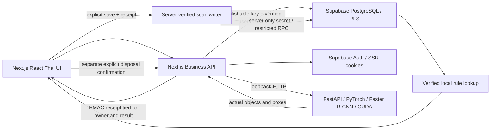

# Product architecture

Active runtime is `web/` and `ai-service/`. MongoDB and Better Auth are not used. SQL source is `database/postgres/0001–0005`; external PostgreSQL/Auth are not configured. Local PGlite is only an isolated test engine with synthetic identities, never a product persistence substitute.

The model detects COCO objects. Recommendation code independently joins published items, active SPU_KK area, verified versioned rules and active verified sources/bins. Unknown or ambiguous conditions return Pending. Material comes from the user, never the model. No artificial campus data is seeded.

Live frames have no automatic DB writes. Photo/snapshot save uses the exact model response. An HMAC receipt expires in five minutes and binds user, prediction UUID and canonical result digest; `/api/scans` verifies it before invoking `persist_verified_scan`. The Supabase secret is imported only by server code for this narrow operation. All other business access uses the normal user session and RLS. The service secret has broad inherent privileges: never move it to a client or reuse this client for general queries.

Disposal events are separately owner-checked and store a rule/source/bin snapshot. Event UUID + owner is idempotent; conflicting payloads fail. Historical client_reported scans are preserved and displayed with provenance. No original image is stored by the current save implementation.

The site and AI bind to `127.0.0.1`; phone access over LAN and insecure camera contexts are not enabled. Supabase Storage is not configured; no public image bucket is created. A later image-retention feature would require private buckets, storage RLS, signed reads, expiry, deletion and explicit policy approval.

## Continuation 2026-11-02

No architecture restart. Candidate0005 adds immutable rule-relationship and audit triggers. Client retry payloads are frozen at first explicit confirmation/submission. Scanner snapshot freezes bytes/stops tracks immediately, waits for in-flight inference, then runs real inference on the frozen image. No image persistence or frame-per-request database writes were added.
